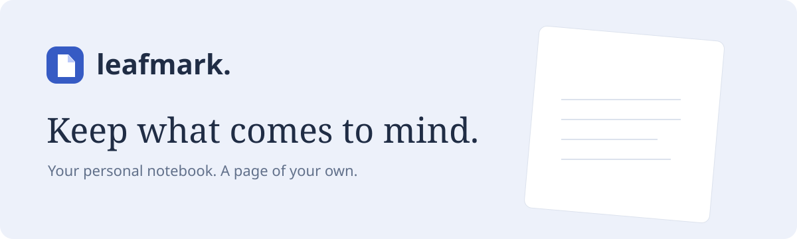
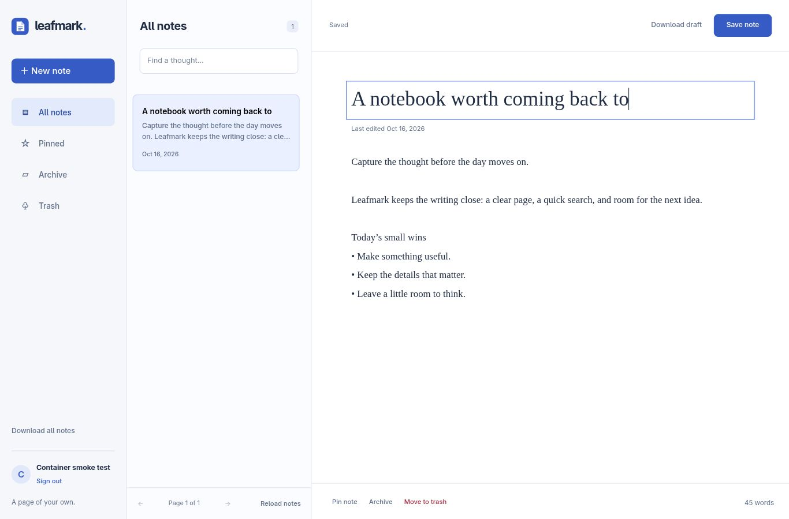

# Leafmark — Personal notebook

Capture a thought, find it later, and keep a copy of your own. Leafmark is a Go web app for private, plain-text notes, with a responsive writing workspace and persistent SQLite or Turso storage.

Run locally with Go, or use Docker Compose. Local SQLite requires no external account. Turso is optional. Production hosting needs HTTPS, durable storage, backups, and registration controls; see [Operations](docs/OPERATIONS.md).

##  Features

- Write and edit titled notes, pin favorites, archive finished thoughts, and restore notes from Trash.
- Search your notebook with paginated results. Concurrent edits are rejected rather than silently overwriting newer text.
- Sign in with a username and password. Browser sessions use revocable HttpOnly cookies; passwords use salted Argon2id hashes.
- Download all notes as JSON, or download your current draft as Markdown—even when a save fails.
- Bring existing Notely notes along using the legacy account migration form.

##  Installation

Requires Go 1.27.1+ or Docker with Compose. The first Go build downloads the modules recorded in `go.sum`.

```sh
test -e .env || cp .env.example .env
# Edit an existing .env instead of overwriting it.
# Set COOKIE_SECURE=false for localhost HTTP.
```

##  Quick start

```sh
go run .
```

Open [localhost:8080](http://localhost:8080), choose **Create account**, and write your first note. Local data goes into `leafmark.db` in the working directory. An existing `.env` with `DATABASE_URL` uses that database instead; back it up before the first upgrade.

Stop the local server with Ctrl+C. Alternatively:

```sh
docker compose up --build -d
```

Compose binds to loopback and keeps the database in the `leafmark-data` volume. Do not run `docker compose down -v` unless you intend to destroy that volume.

##  Usage

Choose **New note**, write a title or text, and select **Save note**. Ctrl/Cmd+S also saves. Changes remain unsaved until the server confirms them. Leaving an edited note opens a discard dialog; failed saves retain the draft in the open tab.

**Pinned** keeps important notes together. **Archive** moves notes out of the active notebook. **Trash** is reversible and never automatically emptied. **Download all notes** includes active, archived, and trashed notes. Notes are displayed as plain text; the app never executes note HTML.

Existing Notely users: choose **Bringing notes from Notely?**, enter your original API key, and choose a username and password. The migration keeps notes and retires the old key. If the key is lost, consult your own original browser profile or backups; Leafmark cannot recover it.

<details>
<summary>Workspace screenshot</summary>



</details>

##  Configuration

| Variable | Default | Purpose |
| --- | --- | --- |
| `PORT` | `8080` | HTTP listening port |
| `DATABASE_URL` | Local `leafmark.db` | Optional libSQL/Turso connection URL; keep credentials private |
| `COOKIE_SECURE` | `true` | Require HTTPS for cookies; explicitly set `false` for localhost HTTP |
| `ALLOW_SIGNUP` | `true` | Set `false` after provisioning accounts for a private deployment |

The server applies additive, transactionally tracked migrations at startup. Existing course `users` and `notes` tables are recognized and preserved. Keep a tested database backup before upgrading. The old Goose migration script now explains this startup behavior.

##  Architecture

One Go process embeds the HTML, CSS, JavaScript, and migrations. Chi routes the API, `database/sql` connects to local SQLite or remote libSQL, and the browser uses same-origin requests. No frontend build pipeline or third-party scripts are required.

| Area | Location |
| --- | --- |
| Server lifecycle, routing, security headers | `main.go` |
| Passwords, sessions, login throttling | `sessions.go` |
| Scoped reads, versioned writes, export | `handler_notes.go` |
| Additive schema migration runner | `storage.go`, `sql/schema/` |
| Workspace and shared UI behavior | `static/` |
| Product, design, and interaction contracts | `PRODUCT.md`, `DESIGN.md`, `UX-CONTRACT.md` |

Authentication attempts are throttled in memory with bounded concurrent password hashing. Run one instance unless your deployment supplies shared rate limiting. There is no email, automated password recovery, public sharing, collaboration, automatic trash purge, or end-to-end encryption. Keep your password in a password manager and export regularly.

##  Verification

```sh
go test -race -cover ./...
go vet ./...
go mod verify
node --check static/app.js
go build ./...
govulncheck ./...
docker build -t leafmark:local .
./scripts/smoke-container.sh leafmark:local
```

Container smoke checks require curl and Python 3. Install the optional vulnerability scanner with `go install golang.org/x/vuln/cmd/govulncheck@latest`. Integration tests cover ownership isolation, stale writes, trash/restore, session revocation, validation, CSRF rejection, throttling, and legacy data migration. CI runs the Go checks, frontend syntax check, vulnerability scan, and a real container test of accounts, notes, export, and restart persistence. The release workflow verifies a container; it does not claim to deploy a public service.

See [Operations](docs/OPERATIONS.md) for HTTPS, backups, restore drills, rollout, and readiness checks, and [API](docs/API.md) for the HTTP contract.

> Origin: Boot.dev's [Learn CI/CD starter](https://github.com/bootdotdev/learn-cicd-starter). Leafmark extends the Notely course application with account sessions, a complete note workflow, conflict detection, a new interface, local persistence, and operational documentation. Maintained by Abdulrahman M. Yaqyn.
